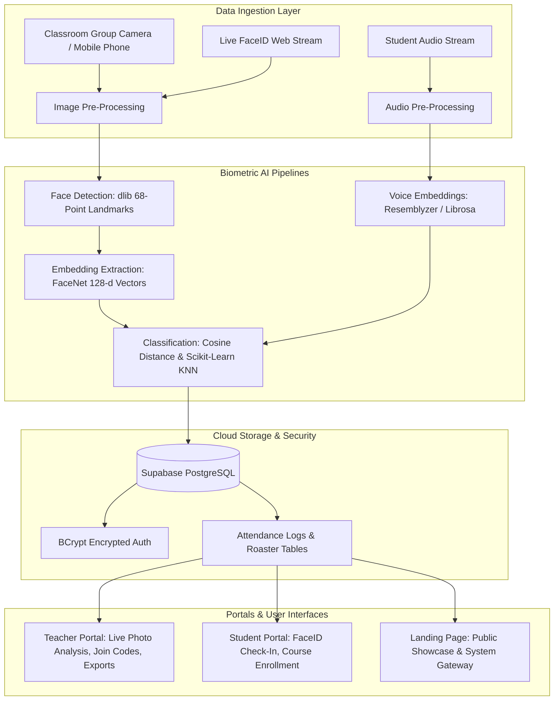

# SMART INDIA HACKATHON 2025
## IDEA SUBMISSION PRESENTATION DOCUMENT
**Project Title:** SnapClass AI – Automated Attendance & Student Identity Verification System  
**Template Specification:** SIH / Praxis Software Presentation Format  
**Matching Content Style:** 179086... Technical Architecture & System Viability Style  

---

## SLIDE 1: TITLE PAGE

### Header
**SMART INDIA HACKATHON 2025**  
**TITLE PAGE**

### Details
- **Problem Statement Title:** Automated Attendance & Student Identity Verification System using AI and Multimodal Biometrics
- **Theme:** Smart Education / Campus Automation & Governance
- **PS Category:** Software
- **Proposed Solution Title:** SnapClass AI – Making Attendance Faster Using AI
- **Team Name:** SnapClass Innovators *(Registered on Google Form)*
- **Team ID:** [Your Team ID]
- **Target Audience:** Universities, Colleges, Schools, Faculty Members & Students

### Core Capabilities Snapshot
- **⚡ Sub-2s Attendance:** Instant classroom group photo face recognition replaces 15 min manual roll call.
- **🎙️ Multimodal Verification:** Facial recognition + voice biometric fallback eliminates proxy check-ins.
- **🔒 Privacy-First Architecture:** Stores only 128-d encrypted vector embeddings, no raw faces retained.
- **📱 Zero Hardware Barrier:** Operates entirely over standard browser webcams and mobile devices via Supabase cloud.

---

## SLIDE 2: PROPOSED SOLUTION

### Header
**PROPOSED SOLUTION**  
*@SIH Idea submission - Template 2 | Team: SnapClass AI*

### ❑ SnapClass: AI-Powered Smart Attendance & Campus Identity System
- **Touchless Biometric Attendance:**  
  Students authenticate effortlessly in sub-seconds via browser/kiosk FaceID without physical contact with biometric fingerprint hardware.
- **One-Shot Classroom Group Scanning:**  
  Educator captures a single wide classroom photo; AI scans, detects, aligns, and concurrently marks all attending students in real-time.
- **Dual-Portal Architecture:**  
  Dedicated student hub (FaceID check-in, course enrollment & personal logs) and teacher workspace (classroom AI sessions, analytics & roster logs).
- **Encrypted Vector Embeddings:**  
  Stores mathematical 128-dimensional face landmark embeddings, safeguarding student data with end-to-end cryptographic privacy.
- **1-Click Automated Onboarding:**  
  Subject join-codes allow fast student self-enrollment and automatic synchronization across courses.

### ❑ Architecture & Visual Flow

### ❑ Innovation & Uniqueness
- **Multimodal Face + Voice Fusion:**  
  Combines dlib/FaceNet facial detection with Resemblyzer voice biometrics for tamper-proof verification and occlusion handling.
- **Zero Dedicated Hardware Required:**  
  Functions entirely on commodity smartphones, laptops, and webcams, eliminating expensive RFID scanners and biometric hardware maintenance.
- **Explainable & Auditable Logs:**  
  Generates transparent attendance audit reports with source image stamps, detection confidence, and instant CSV/Excel exports.
- **Adaptive Vector Clustering:**  
  KNN & Cosine-similarity vector classification dynamically recognizes students under varying classroom lighting, angles, and facial expressions.

---

## SLIDE 3: TECHNICAL APPROACH

### Header
**TECHNICAL APPROACH & ARCHITECTURE**  
*@SIH Idea submission - Template 3 | Team: SnapClass AI*

### Architecture Flowchart

### Module Breakdown & Tech Stack
1. **Data Ingestion Layer:**
   - Classroom Camera Input, Live FaceID Video Stream, Audio Recording.
   - **Tech:** Streamlit Camera API, HTML5 Canvas, OpenCV, WebSockets.
2. **Biometric Feature Extraction:**
   - 68-point facial landmark alignment, 128-d Euclidean vector encodings, voice spectral features.
   - **Tech:** PyTorch, dlib-bin, face_recognition, Resemblyzer, Librosa.
3. **Classification & Matching Engine:**
   - KNN classification, multi-face batch matching, cosine similarity thresholding.
   - **Tech:** Scikit-Learn, NumPy, SciPy.
4. **Cloud Database & Security:**
   - Cloud relational database, vector embedding storage, relational integrity, 60s resilient connection timeout.
   - **Tech:** Supabase (PostgreSQL), BCrypt, PostgREST.
5. **Portals & Frontend:**
   - Responsive portals for faculty and students, clean export tools (CSV/Excel).
   - **Tech:** Streamlit, Flask, Pandas, Segno (QR codes).

---

## SLIDE 4: FEASIBILITY AND VIABILITY

### Header
**FEASIBILITY AND VIABILITY**  
*@SIH Idea submission - Template 4 | Team: SnapClass AI*

| FEASIBILITY | VIABILITY |
| :--- | :--- |
| **• Hardware-Free Deployment:** Uses standard laptops, webcams, or smartphones already available in classrooms without specialized RFID/biometric hardware. | **• High Return on Teaching Time:** Eliminates 10-15 minutes of wasted roll-call per lecture, reclaiming ~40 instructional hours per educator annually. |
| **• Scalable Cloud Architecture:** Cloud-native Supabase PostgreSQL database handles thousands of concurrent lecture requests with automated connection pooling. | **• Paperless Institutional Audits:** Tamper-proof digital records replace error-prone manual paper attendance sheets with 1-click administrative exports. |
| **• Rapid Model Inference:** Pre-trained deep embedding extractors execute inference in sub-seconds without requiring high-end GPU servers per classroom. | **• Scalable SaaS Model:** Freemium model for individual teachers; institutional tier for schools, colleges, and university-wide ERP integration. |

| CHALLENGES & RISKS | STRATEGIES & MITIGATION |
| :--- | :--- |
| **• Classroom Lighting & Pose Variance:** Shadows, seated angles, and occlusions in large lecture halls. | **• Multi-Angle Burst & Histogram Normalization:** Adaptive contrast normalization and multi-photo burst stitching for comprehensive coverage. |
| **• Proxy & Image Spoofing:** Possibility of presenting printed photos or phone screen snapshots. | **• Multimodal Voice + Facial Liveness:** Voice verification check and interactive camera detection eliminate spoofing and proxy attempts. |
| **• Biometric Data Privacy Concerns:** Student apprehension regarding sensitive facial photo storage. | **• Irreversible Vector Encodings:** Zero raw facial images stored permanently; only 128-d irreversible floating-point vectors are encrypted. |

---

## SLIDE 5: IMPACT AND BENEFITS

### Header
**IMPACT AND BENEFITS**  
*@SIH Idea submission - Template 5 | Team: SnapClass AI*

### Stakeholder Benefits
- **🎓 Educators & Professors:**  
  Reclaim 15% of active lecture time previously wasted on manual calling; generate instant CSV/Excel attendance sheets with zero paperwork.
- **👨‍🎓 Students:**  
  100% transparent attendance logging; zero disputes; seamless self-enrollment via course join codes and contact-free biometric check-in.
- **🏛️ Institutions & Universities:**  
  Tamper-proof academic audit records; real-time visibility into attendance shortages; automated compliance with UGC / AICTE regulations.
- **📊 Campus Administration:**  
  Centralized attendance analytics across departments; early warning indicators for at-risk students with low attendance.

### Quantitative Impacts
- **⚡ 95% Time Reduction:** Attendance time slashed from 10–15 minutes down to <2 seconds per lecture.
- **🚫 100% Proxy Elimination:** Multimodal facial biometrics + voice verification eradicate fake student proxies.
- **⏰ 40+ Hours Saved / Year:** Over 40 instructional hours returned to each educator every academic year.
- **🌱 100% Paperless & Green:** Zero physical paper registers, directly supporting Digital India and eco-friendly campus mandates.
- **📊 Instant Audit Readiness:** 1-click generation of official attendance reports, saving administrative verification time.

---

## SLIDE 6: RESEARCH AND REFERENCES

### Header
**RESEARCH AND REFERENCES**  
*@SIH Idea submission - Template 6 | Team: SnapClass AI*

### Academic & Technical Foundations
- **Google FaceNet (CVPR):**  
  *Schroff, F., Kalenichenko, D., & Philbin, J.* "FaceNet: A Unified Embedding for Face Recognition and Clustering." IEEE Conference on Computer Vision and Pattern Recognition (CVPR).  
- **dlib Landmark Localization:**  
  *King, D. E.* "Dlib-ml: A Machine Learning Toolkit." Journal of Machine Learning Research.  
- **Generalized Voice Biometrics:**  
  *Wan, L., Wang, Q., Papir, A., & Moreno, I. L.* "Generalized End-to-End Loss for Speaker Verification." Google AI / IEEE ICASSP.  
- **Resemblyzer & Librosa Studies:**  
  Spectral audio feature extraction and deep voiceprint speaker verification in acoustic classroom environments.  
- **National Education Policy (NEP 2020) & Digital India:**  
  Mandates for paperless, tech-enabled classroom operations, academic audit transparency, and smart campus governance.

### Project Deliverables & Links
- **▶️ Demonstration Video (YouTube):** `https://youtu.be/your-demo-link`  
  *(Live walkthrough of multi-face classroom scanning, student FaceID login, and real-time report generation)*
- **💻 GitHub Repository:** `https://github.com/your-username/SnapClass-AI-Attendance`  
  *(Production codebase with Streamlit app, Flask landing page, and Supabase database integration)*
- **🌐 Live Web Application:** `http://localhost:8501` *(Local)* / `https://snapclass.streamlit.app` *(Cloud)*
- **📄 Database Schema & Architecture:** [`schema.sql`](file:///c:/Users/hp/Documents/Attendance/schema.sql)  
  *(Relational schema with teachers, students, subjects, enrollments, and attendance logs)*
